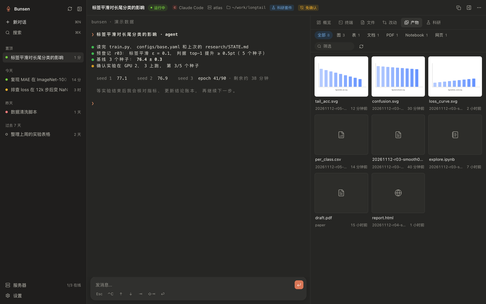
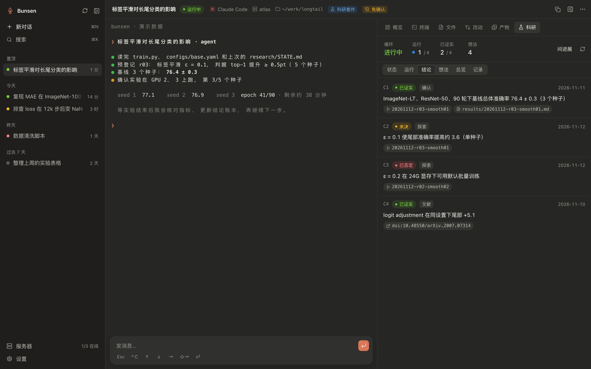
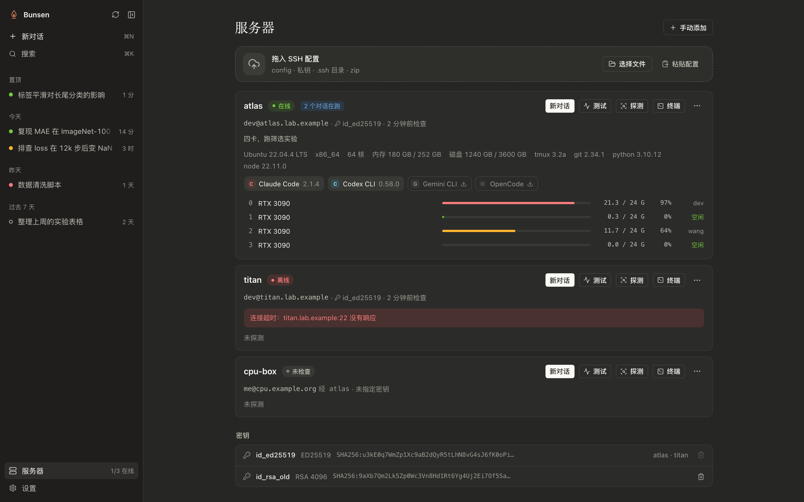
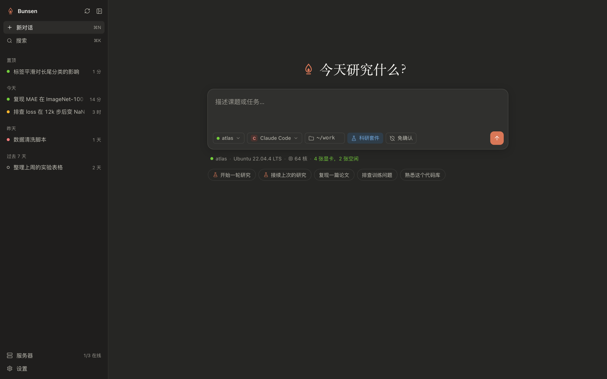
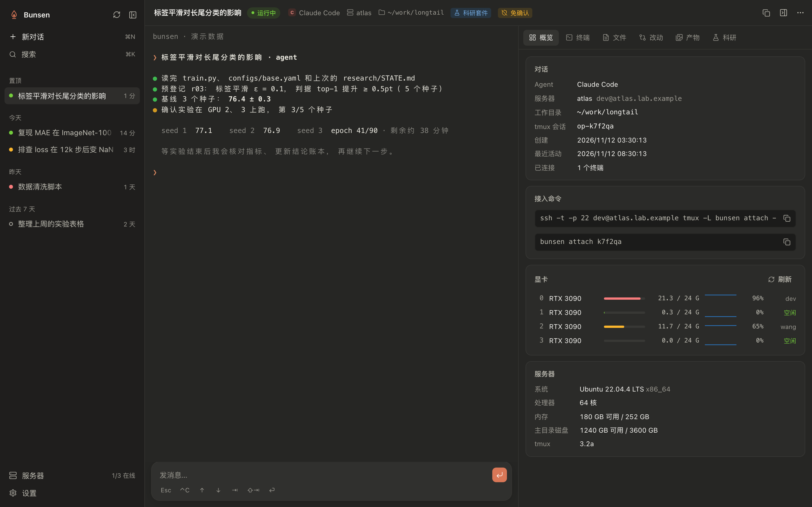
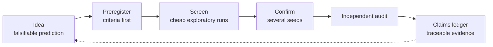
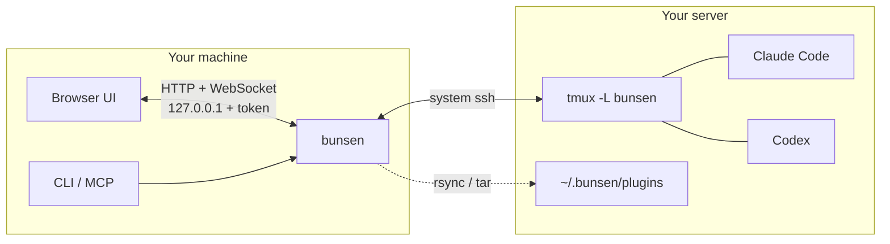

<div align="center">


# Bunsen

**An open-source AI research workbench. Let Claude Code, Codex and other agents do research on your own GPU servers, even with your laptop closed.**

[](https://github.com/sweetcornna/bunsen/releases/latest)
[](https://github.com/sweetcornna/bunsen/actions/workflows/ci.yml)
[](LICENSE)


[Install](#install) · [Quick start](#quick-start) · [Research workflow](#research-workflow) · [As a service](#as-a-service-cli-http-and-mcp) · [中文](README.md)



</div>

> The interface is in Chinese for now.

## What it is

Bunsen is a self-hosted research workbench in the spirit of Claude Science: agents, compute, experiment records and artifacts in one window. Its choices are to run on your own servers, work with any agent, and be fully open source.

The name comes from the Bunsen burner, the flame that stays lit on every lab bench.

- **Research with a record.** Preregistrations, runs, metrics, a claims ledger and ideas. Every claim links back to its evidence.
- **Artifacts you can see.** Figures, tables, PDFs and notebooks are collected into a gallery that shows which run produced each one.
- **Your own compute.** Connect your lab's GPU servers over SSH and watch each card's usage and user live.
- **Long jobs survive disconnects.** Conversations run in tmux on the server. Quit or close the laptop and they continue; find them again from another computer.
- **Any agent.** Claude Code, Codex, Gemini CLI, Qwen Code, OpenCode, Cursor Agent, Aider, or one you add yourself.
- **A workbench and a service.** One executable provides the UI, a CLI, an HTTP API and an MCP server, so other agents and scripts can drive it.

## Features

<table>
<tr>
<td width="50%"><b>Research panel</b><br>Runs, claims and ideas. Every claim links to its evidence.<br><br></td>
<td width="50%"><b>Servers and GPUs</b><br>Drop in <code>~/.ssh/config</code> and your keys. Bunsen matches keys, tests the connection and probes the machine and its GPUs.<br><br></td>
</tr>
<tr>
<td><b>Start a study</b><br>Describe the question, pick a server, an agent and a working directory, then press ⌘↵. The research plugin ships with the deploy.<br><br></td>
<td><b>Overview and attach</b><br>Live GPU usage, and a command you can paste into any terminal to attach.<br><br></td>
</tr>
</table>

## Install

**macOS / Linux**

```bash
curl -fsSL https://raw.githubusercontent.com/sweetcornna/bunsen/main/install.sh | sh
```

**Windows** (PowerShell)

```powershell
irm https://raw.githubusercontent.com/sweetcornna/bunsen/main/install.ps1 | iex
```

The script downloads the executable for your platform, checks its SHA-256 and installs it to `~/.local/bin` (`%LOCALAPPDATA%\Programs\bunsen` on Windows). Set `BUNSEN_VERSION=v0.1.0` to pin a version and `BUNSEN_INSTALL_DIR` to change the directory. Run it again to update; delete the file to uninstall.

<details>
<summary><b>Manual download</b></summary>
<br>

| OS | Architecture | Download |
|---|---|---|
| macOS | Apple silicon | [bunsen-aarch64-apple-darwin.tar.gz](https://github.com/sweetcornna/bunsen/releases/latest/download/bunsen-aarch64-apple-darwin.tar.gz) |
| macOS | Intel | [bunsen-x86_64-apple-darwin.tar.gz](https://github.com/sweetcornna/bunsen/releases/latest/download/bunsen-x86_64-apple-darwin.tar.gz) |
| Linux | x86_64 | [bunsen-x86_64-unknown-linux-musl.tar.gz](https://github.com/sweetcornna/bunsen/releases/latest/download/bunsen-x86_64-unknown-linux-musl.tar.gz) |
| Linux | ARM64 | [bunsen-aarch64-unknown-linux-musl.tar.gz](https://github.com/sweetcornna/bunsen/releases/latest/download/bunsen-aarch64-unknown-linux-musl.tar.gz) |
| Windows | x86_64 | [bunsen-x86_64-pc-windows-msvc.zip](https://github.com/sweetcornna/bunsen/releases/latest/download/bunsen-x86_64-pc-windows-msvc.zip) |

Unpack it and put `bunsen` anywhere on your `PATH`. The macOS builds are notarized by Apple; the Linux builds are statically linked.

</details>

<details>
<summary><b>Build from source</b></summary>
<br>

Requires stable Rust, Node 22 and pnpm.

```bash
git clone https://github.com/sweetcornna/bunsen.git
cd bunsen
./build.sh
```

The executable is at `target/release/bunsen`.

</details>

**Requirements**

| | Needs |
|---|---|
| Your machine | An OpenSSH client (`ssh`). macOS, Linux and Windows 10 or later ship one |
| Server | Linux with `tmux` and `bash`. `rsync` and `python3` make things faster but are optional |

## Quick start

```bash
bunsen serve
```

Your browser opens `http://127.0.0.1:7878`.

1. **Add a server.** On the Servers page, drop in `~/.ssh/config`, private keys, a whole `.ssh` directory or a zip. You can also paste a config or fill in the form. Bunsen matches a key to each host and tests the connection.
2. **Install an agent.** Click an agent that is not installed yet on the server card, choose an install method, then sign in from the login terminal.
3. **Start a study.** Describe the question on the home page, pick a server, an agent and a working directory, and press ⌘↵. Each deploy step is shown as it runs.
4. **Work.** The agent's terminal is on the left. Type into it directly, or write a longer message in the box below and send it. Text you select in a file or an artifact can be quoted into the message.
5. **Come back.** Reopening Bunsen checks every server for the current state. If the agent process has exited you can resume the conversation, and every session has an attach command that works in any terminal.

## Supported agents

| Agent | Resume | Skip approvals | Plugins |
|---|:---:|:---:|---|
| Claude Code | ✓ | ✓ | Loaded directly (`--plugin-dir`) |
| Codex CLI | ✓ | ✓ | Pointed to from the first message |
| Gemini CLI | ✓ | ✓ | Same |
| Qwen Code | | ✓ | Same |
| OpenCode | ✓ | | Same |
| Cursor Agent | ✓ | | Same |
| Aider | | ✓ | Same |
| Plain shell (bash) | | | |

Edit these commands, or add your own agent, under Settings → Agent.

## Research workflow

The bundled [research plugin](plugins/research) makes the agent follow a constrained process instead of running whatever comes to mind:



- **Plugins ship with every deploy.** The plugin is compiled into the executable and synced to `~/.bunsen/plugins/` on the server. Claude Code loads it directly (`/research:start`, `/research:resume`, `/research:status`); other agents are pointed to the same process documents in their first message. Keys, `.env` files and lab profiles are never synced.
- **The research panel** reads `research/` in the working directory: runs (log, metrics, result page; live runs refresh on their own), the claims ledger, ideas and the overview.
- **Artifacts** collects figures, tables, PDFs, notebooks and web pages with thumbnails and previews, and shows which run most likely produced each one.
- **GPUs** show live usage and who is using each card.
- **Host notes.** One `~/.bunsen/HOST.md` per server for that machine's rules and pitfalls.
- **Quoting.** Select text in a file or an artifact and send it along with your message.

## How it works



Each conversation is a tmux session on the server, on a socket that belongs to Bunsen and leaves your own tmux alone. Your machine stores the server list, keys and a session index. Session metadata is also written to `~/.bunsen/` on the server, so importing the same SSH config on another computer finds the sessions again.

## As a service: CLI, HTTP and MCP

The UI is only one way in. Everything it does is available from the command line and the HTTP API. Add `--json` for scripts.

```bash
bunsen import ~/.ssh/config ~/.ssh/id_ed25519
bunsen deploy --server gpu1 --agent claude-code --workdir '~/proj' --prompt 'Reproduce table 2 of the paper'
bunsen sessions
bunsen send <id> 'Run the unit tests first'
bunsen capture <id> --lines 40
bunsen attach <id>
```

As an MCP server, so another agent can manage these research sessions and read their runs and artifacts:

```bash
claude mcp add bunsen -- bunsen mcp
```

The API contract is in [docs/API.md](docs/API.md) and the internal design in [docs/CORE-DESIGN.md](docs/CORE-DESIGN.md) (both in Chinese).

## Security

- The server listens on `127.0.0.1` only and uses a new random token on every start.
- Private keys stay in the local data directory (mode 0600). No endpoint returns key material.
- Connections use the system `ssh` with a config and `known_hosts` that belong to Bunsen. Your `~/.ssh` is not modified.
- On the server, Bunsen writes only to `~/.bunsen/` and the working directory you choose.
- HTML from the server is previewed only in a sandboxed iframe with no permissions.
- "Skip approvals" lets the agent act without asking. Turn it on only for machines and directories you trust.

## FAQ

<details>
<summary>How do I check that the macOS build is genuine?</summary>
<br>

The macOS builds are signed with a Developer ID and notarized by Apple, so a copy downloaded with a browser opens normally. To check it yourself:

```bash
spctl -a -vv -t install ./bunsen
```

The output should include `source=Notarized Developer ID`.

</details>

<details>
<summary>The server has no tmux</summary>
<br>

Install it with the system package manager, for example `sudo apt install tmux`. Without root, put a static tmux build in `~/.local/bin`; Bunsen looks there.

</details>

<details>
<summary>How do agents sign in on the server?</summary>
<br>

Follow the agent's own prompts in the terminal after deploying. You can also put API keys in `~/.bunsen/env.sh` on the server; every session sources it on start.

</details>

<details>
<summary>What is different on Windows?</summary>
<br>

The OpenSSH client that ships with Windows has no connection multiplexing, so every operation opens a new SSH connection and is slower than on macOS or Linux. The Windows build is a preview.

</details>

## Development

```
crates/core        Core library: ssh config, keys, probing, deploy, tmux, terminal bridge, plugins
crates/cli         bunsen: serve (HTTP + WebSocket + embedded UI), subcommands, MCP
ui/                React + Vite + TypeScript UI, embedded into the executable
plugins/           Plugins shipped with every deploy, also embedded
dev/               Demo backend, SSH test container, integration tests, screenshot script
```

```bash
cargo run -p bunsen-cli -- serve --dev --no-open
```

```bash
pnpm -C ui dev
```

To look at the UI without a server: `bun dev/mock-server.ts`. Tests: `cargo test --workspace`. Integration tests need `dev/test-server/run.sh up` first, then `dev/itest.sh`.

## Notes

Bunsen is an independent open-source project and is not affiliated with Anthropic, OpenAI, Google, Alibaba Cloud, Cursor or any other vendor. Agent names and trademarks belong to their owners. The product direction is inspired by Claude Science, and the colours and layering of the interface by Claude Desktop. The brand, icons and code are original.

## License

[MIT](LICENSE)
