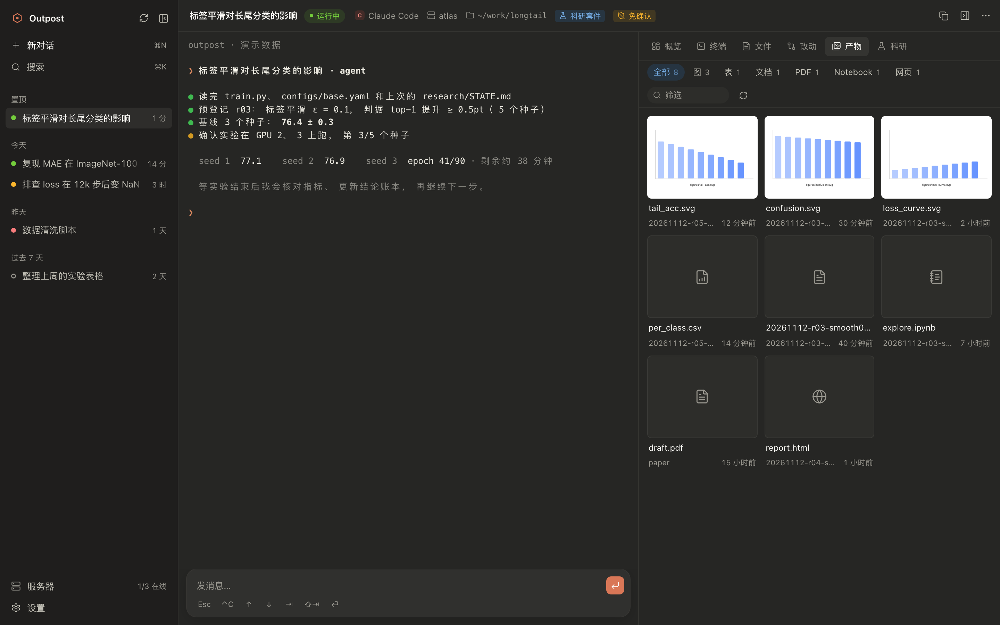
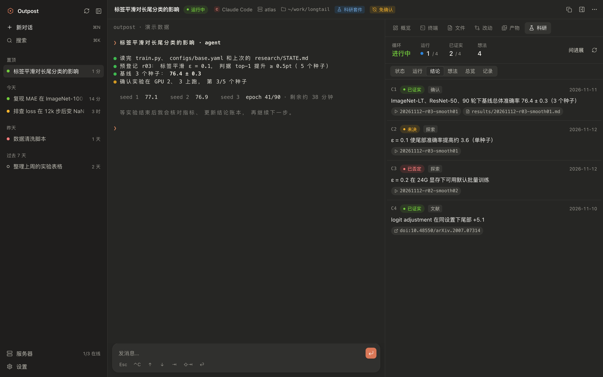
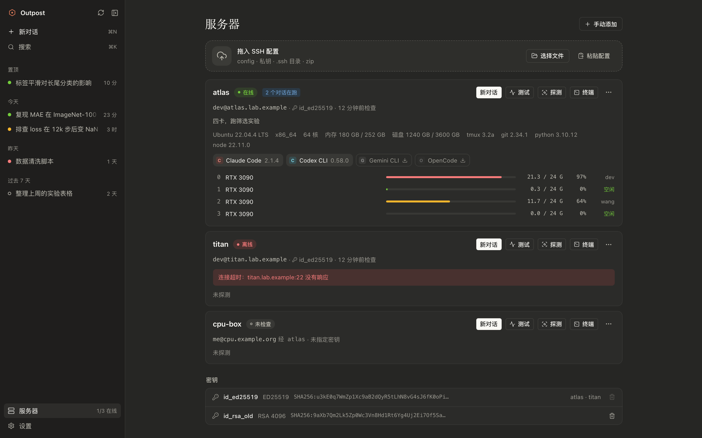
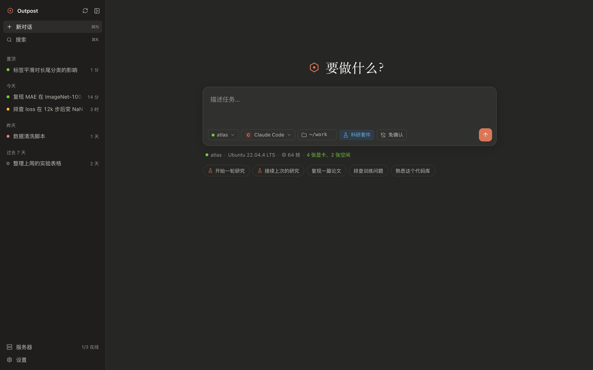
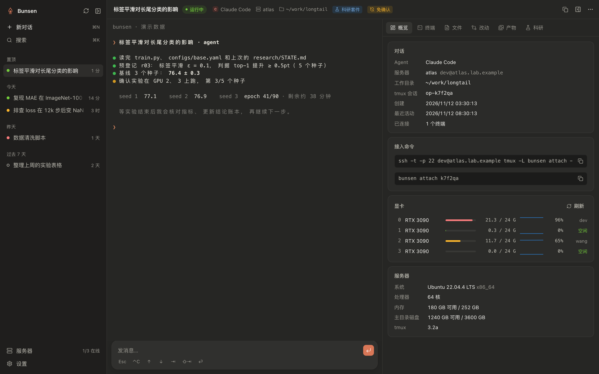
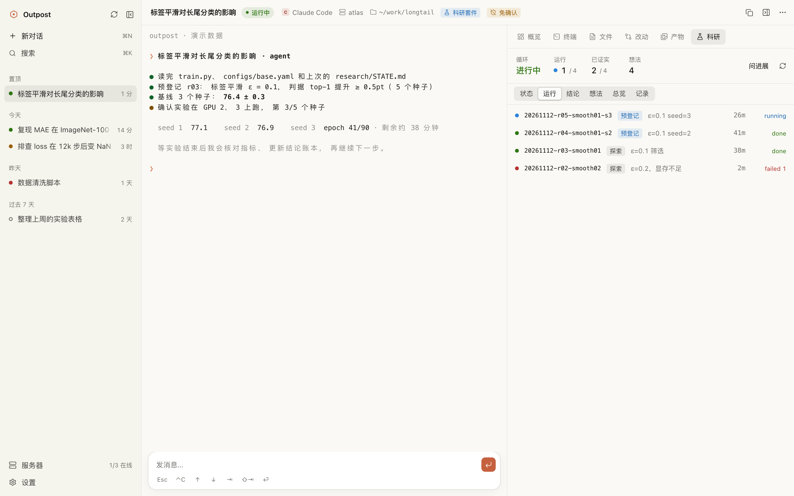
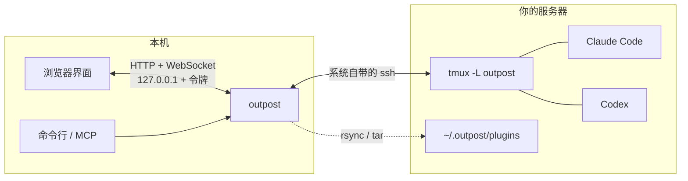

<div align="center">


# Outpost

**开源的 AI 科研工作台。让 Claude Code、Codex 这些 Agent 在你自己的 GPU 服务器上做研究，关掉电脑也不停。**

[](https://github.com/sweetcornna/outpost/releases/latest)
[](https://github.com/sweetcornna/outpost/actions/workflows/ci.yml)
[](LICENSE)


[安装](#安装) · [快速开始](#快速开始) · [科研工作流](#科研工作流) · [作为服务](#作为服务命令行http-与-mcp) · [English](README.en.md)



</div>

## 这是什么

Outpost 是一个自托管的科研工作台，定位类似 Claude Science：把 Agent、算力、实验记录和产物放进同一个窗口。它的取舍是：跑在你自己的服务器上，Agent 任选，全部开源。

- **研究全程有记录**：预登记、运行、指标、结论账本、想法；每条结论都能点回它的证据。
- **产物看得见**：图、表、PDF、Notebook 自动汇总成画廊，并标出出自哪次运行。
- **算力是你自己的**：用 SSH 接入实验室的 GPU 服务器，实时看每张卡的占用和使用者。
- **长任务不怕断线**：对话跑在服务器的 tmux 里，退出、合上电脑都不停；换一台电脑也能找回来。
- **Agent 任选**：Claude Code、Codex、Gemini CLI、Qwen Code、OpenCode、Cursor Agent、Aider，也可以自己加。
- **既是工作台，也是服务**：一个可执行文件，同时提供界面、命令行、HTTP 接口和 MCP，别的 Agent 和脚本也能调度它。

## 功能

<table>
<tr>
<td width="50%"><b>科研面板</b><br>运行、结论、想法；每条结论的证据都能点开。<br><br></td>
<td width="50%"><b>服务器与显卡</b><br>拖入 <code>~/.ssh/config</code> 和私钥，自动配对、测连接、探测环境和显卡。<br><br></td>
</tr>
<tr>
<td><b>开始一轮研究</b><br>写下课题，选服务器、Agent、工作目录，⌘↵。科研插件随部署一起下发。<br><br></td>
<td><b>概览与接入</b><br>显卡实时占用，以及一条能在任何终端里粘贴的接入命令。<br><br></td>
</tr>
</table>

<details>
<summary>浅色主题</summary>
<br>

</details>

## 安装

**macOS / Linux**

```bash
curl -fsSL https://raw.githubusercontent.com/sweetcornna/outpost/main/install.sh | sh
```

**Windows**（PowerShell）

```powershell
irm https://raw.githubusercontent.com/sweetcornna/outpost/main/install.ps1 | iex
```

脚本会下载对应平台的可执行文件、核对 SHA-256，装到 `~/.local/bin`（Windows 是 `%LOCALAPPDATA%\Programs\outpost`）。用 `OUTPOST_VERSION=v0.1.0` 指定版本，`OUTPOST_INSTALL_DIR` 指定目录。更新就再跑一遍；卸载就删掉那个文件。

<details>
<summary><b>手动下载</b></summary>
<br>

| 系统 | 架构 | 下载 |
|---|---|---|
| macOS | Apple 芯片 | [outpost-aarch64-apple-darwin.tar.gz](https://github.com/sweetcornna/outpost/releases/latest/download/outpost-aarch64-apple-darwin.tar.gz) |
| macOS | Intel | [outpost-x86_64-apple-darwin.tar.gz](https://github.com/sweetcornna/outpost/releases/latest/download/outpost-x86_64-apple-darwin.tar.gz) |
| Linux | x86_64 | [outpost-x86_64-unknown-linux-musl.tar.gz](https://github.com/sweetcornna/outpost/releases/latest/download/outpost-x86_64-unknown-linux-musl.tar.gz) |
| Linux | ARM64 | [outpost-aarch64-unknown-linux-musl.tar.gz](https://github.com/sweetcornna/outpost/releases/latest/download/outpost-aarch64-unknown-linux-musl.tar.gz) |
| Windows | x86_64 | [outpost-x86_64-pc-windows-msvc.zip](https://github.com/sweetcornna/outpost/releases/latest/download/outpost-x86_64-pc-windows-msvc.zip) |

解压后把 `outpost` 放进 `PATH` 里的任意目录。macOS 版经过 Apple 公证；Linux 版是静态链接的，不挑发行版。

</details>

<details>
<summary><b>从源码构建</b></summary>
<br>

需要 Rust stable、Node 22 和 pnpm。

```bash
git clone https://github.com/sweetcornna/outpost.git
cd outpost
./build.sh
```

产物在 `target/release/outpost`。

</details>

**运行环境**

| | 需要 |
|---|---|
| 本机 | OpenSSH 客户端（`ssh`）。macOS、Linux 和 Windows 10 及以上都自带 |
| 服务器 | Linux，有 `tmux` 和 `bash`；装了 `rsync`、`python3` 会更快，没有也能用 |

## 快速开始

```bash
outpost serve
```

浏览器会打开 `http://127.0.0.1:7878`。

1. **接服务器**。在“服务器”页把 `~/.ssh/config`、私钥、整个 `.ssh` 目录或 zip 拖进去，也可以粘贴配置或手动填。Outpost 自动给每台机器配对密钥并测试连接。
2. **装 Agent**。点服务器卡片上还没装的 Agent，选一种安装方式，装完在“登录终端”里完成登录。
3. **开始研究**。回到首页写课题，选服务器、Agent、工作目录，按 ⌘↵。部署过程逐步显示：连接 → 检查 tmux → 查找 Agent → 准备目录 → 同步插件 → 启动 → 确认。
4. **干活**。左边是 Agent 的终端，可以直接打字，也可以在下面的输入条里写好一段再发过去；在文件或产物里选中的内容可以“引用”进消息。
5. **回来接着用**。重新打开 Outpost 会向各台服务器核对状态。Agent 进程退了可以“接续对话”；每个会话都有一条接入命令，在任何终端里粘贴即可。

## 支持的 Agent

| Agent | 接续 | 免确认 | 插件 |
|---|:---:|:---:|---|
| Claude Code | ✓ | ✓ | 直接加载（`--plugin-dir`） |
| Codex CLI | ✓ | ✓ | 首条消息里指向插件文档 |
| Gemini CLI | ✓ | ✓ | 同上 |
| Qwen Code | | ✓ | 同上 |
| OpenCode | ✓ | | 同上 |
| Cursor Agent | ✓ | | 同上 |
| Aider | | ✓ | 同上 |
| 纯终端（bash） | | | |

在“设置 → Agent”里可以改这些命令，或者加自己的。

## 科研工作流

内置的 [research 插件](plugins/research)让 Agent 按一套有约束的流程做研究，而不是想到哪跑到哪：


- **插件随部署下发**。插件编进了可执行文件，部署时同步到服务器的 `~/.outpost/plugins/`；Claude Code 直接加载（`/research:start`、`/research:resume`、`/research:status`），其它 Agent 在首条消息里被指向同一套流程文档。密钥、`.env`、实验室档案不会被同步。
- **科研面板**读工作目录下的 `research/`：运行（日志、指标、结果页，在跑的自动刷新）、结论账本、想法、总览。
- **产物**汇总图、表、PDF、Notebook、网页，带缩略图和预览，并标出大概出自哪次运行。
- **显卡**实时显示每张卡的占用和使用者，避免抢到别人的卡。
- **主机笔记**：每台服务器一份 `~/.outpost/HOST.md`，记这台机器的规矩和坑。
- **引用**：在文件或产物里选中一段，随消息一起发给 Agent。

## 工作原理



每个对话是服务器上一个 tmux 会话，跑在 Outpost 专用的套接字上，不碰你自己的 tmux。本机只保存服务器列表、密钥和会话索引；会话的元数据同时写在服务器的 `~/.outpost/` 里，所以换一台电脑导入同样的 SSH 配置就能把它们找回来。

## 作为服务：命令行、HTTP 与 MCP

界面只是其中一个入口。界面能做的事，命令行和 HTTP 接口都能做，加 `--json` 给脚本用。

```bash
outpost import ~/.ssh/config ~/.ssh/id_ed25519
outpost deploy --server gpu1 --agent claude-code --workdir '~/proj' --prompt '复现论文的表 2'
outpost sessions
outpost send <id> '先跑单元测试'
outpost capture <id> --lines 40
outpost attach <id>
```

作为 MCP 服务，让另一个 Agent 来调度这些研究会话、读运行记录和产物：

```bash
claude mcp add outpost -- outpost mcp
```

接口约定见 [docs/API.md](docs/API.md)，内部设计见 [docs/CORE-DESIGN.md](docs/CORE-DESIGN.md)。

## 安全

- 服务只监听 `127.0.0.1`，每次启动换一个随机令牌。
- 私钥只存在本机数据目录（权限 0600），任何接口都不返回私钥内容。
- 连接用系统的 `ssh`，配置和 `known_hosts` 是 Outpost 自己的一份，不改你的 `~/.ssh`。
- 服务器上只写 `~/.outpost/` 和你指定的工作目录。
- 服务器上的 HTML 只在无权限的沙箱 iframe 里预览。
- “免确认”会让 Agent 跳过权限确认，只在信得过的机器和目录上打开。

## 常见问题

<details>
<summary>怎么确认下载的 macOS 版是正版</summary>
<br>

macOS 版用 Developer ID 签名并经过 Apple 公证，浏览器下载的也能直接打开。想自己核对：

```bash
spctl -a -vv -t install ./outpost
```

输出里应当有 `source=Notarized Developer ID`。

</details>

<details>
<summary>服务器上没有 tmux</summary>
<br>

用系统的包管理器装一个，例如 `sudo apt install tmux`。没有管理员权限的话，可以把静态编译的 tmux 放到 `~/.local/bin`，Outpost 会去那里找。

</details>

<details>
<summary>Agent 在服务器上怎么登录</summary>
<br>

部署后在终端里按 Agent 自己的提示登录即可；也可以把 API 密钥写进服务器的 `~/.outpost/env.sh`，每个会话启动前都会加载它。

</details>

<details>
<summary>Windows 上有什么不同</summary>
<br>

Windows 自带的 OpenSSH 不支持连接复用，所以每个操作都会新建一次 SSH 连接，比 macOS / Linux 慢一些。Windows 版目前是预览。

</details>

## 开发

```
crates/core        核心库：ssh 配置、密钥、探测、部署、tmux、终端桥接、插件
crates/cli         outpost：serve（HTTP + WebSocket + 内嵌界面）、子命令、MCP
ui/                React + Vite + TypeScript 界面，构建产物内嵌进可执行文件
plugins/           随部署下发的插件，同样内嵌
dev/               演示后端、测试用 SSH 容器、集成测试、截图脚本
```

```bash
cargo run -p outpost-cli -- serve --dev --no-open
```

```bash
pnpm -C ui dev
```

只看界面不连服务器：`bun dev/mock-server.ts`。测试：`cargo test --workspace`；集成测试要先 `dev/test-server/run.sh up`，再 `dev/itest.sh`。

## 说明

Outpost 是独立的开源项目，与 Anthropic、OpenAI、Google、阿里云、Cursor 等公司没有关联，各产品的名称和商标归其所有者。产品定位受 Claude Science 启发，界面的配色和层次受 Claude Desktop 启发；品牌、图标和代码都是自己的。

## 许可证

[MIT](LICENSE)
